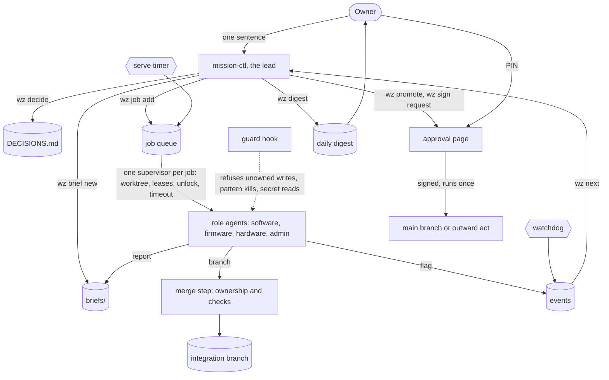

# wz

wz is a mission control for a team of AI coding agents. One lead agent, `mission-ctl`, turns your short instructions
into briefs and queued jobs. Role agents do the work on their own branches, inside the paths they own. A hook refuses
what a role may not do. Nothing ships, sends or pays until you sign.

It runs on one Linux or macOS machine with Python 3.11+ and [Claude Code](https://docs.claude.com/en/docs/claude-code).
It uses only the Python standard library.

**Want to install it?** [Install with Claude](#install-with-claude-recommended): paste one message into Claude Code and
Claude does the rest (no programming needed). [Install by hand](#install-by-hand-for-developers) is for developers.

> Status: early (0.1). The machinery below is tested; the conventions are the ones it was extracted from. Expect
> rough edges, and read the guard's limits before you trust it with anything you cannot undo.

## What it is

You talk only to the lead. The lead records what you said as a numbered decision in your own words, writes a brief,
and queues one job per piece of work. A timer serves each job: it creates a git worktree on a fresh branch, holds any
instrument or device the job leased, and runs a Claude Code session with the role's charter. The job ends with a
written report and a closing declaration (`done` with evidence, or `blocked` with a reason). A merge step integrates
green branches. Releases and outward acts wait on an approval page until you enter your PIN. Each morning a digest
tells you what finished and what waits, with at most three asks.

Everything is a file: `wz.toml` (the one config), `DECISIONS.md`, `briefs/`, `ledgers/`, `status/`, and wz's own
state under `.wz/`. Agents coordinate through those files, not by messaging each other.

## Four uses

The core does not care whether the work is code. The workflow packs give each kind of role its default rules.

**Software.** Roles own paths in git repositories. Jobs run on `wz/<role>/<job>` branches. The merge step runs your
checks and moves the integration branch. You sign each release from integration to main.

```sh
wz job add app "add CSV export to the history page" --evidence "tests/test_export.py passes"
wz merge                 # the merge timer does this every 5 minutes
wz promote app           # asks you to sign: main -> the integration commit, by sha
```

**Firmware.** Build and flash jobs lease the device they use, so two jobs never flash the same board.

```sh
wz job add firmware "move the controller's sampling loop to the hardware timer" --lease board-a --timeout 2h
```

**Hardware.** Bench instruments and devices are resources in `wz.toml`. A job holds its leases from start to end. A
chat session can hold one for a single command.

```sh
wz job add bench "measure board-a idle current at 3.3 V and 5 V" --lease bench-psu --lease board-a
wz lease run bench-psu -- python3 bench/sweep.py
```

**Admin.** Documents, email and finance drafts live in a folder store. The agent drafts. Every outward act is a sign
request carrying the exact command. It runs once, after you sign, and only if the request has not changed since.

```sh
wz job add writer "draft the quarterly supplier letter from notes/q3.md"
wz sign request "Email the Q3 letter to the supplier" --cmd "./send-mail drafts/q3-letter.eml"
wz sign approve sign-0001        # or tap Sign on the approval page
wz sign run sign-0001
```

## Worked examples

| Example | For | What it shows |
|---|---|---|
| [examples/qual-guides](examples/qual-guides) | someone who has never used a terminal | a small team that turns a project description into an interview guide and checks it against published advice, with a finished sample and its cost |
| [examples/fernhill](examples/fernhill) | the setup answers | a made-up greenhouse controller set up from an answers file |
| [examples/fernhill-bench](examples/fernhill-bench) | the bench loop | the same project run end to end on simulated hardware |

## Bench loop

The bench loop is hardware : firmware : software : app : instrument, run as one scenario under one set of leases.
Full reference: [docs/BENCH-LOOP.md](docs/BENCH-LOOP.md).

1. Make the change on a branch (a job does this already).
2. Host build and tests.
3. Firmware build, gated on flash and RAM limits from `[bench.budget.<target>]`.
4. Flash a device under test. The job holds the device's **lease**: a lock file naming the job. The lease ends when
   the job exits or times out, and nothing ever takes it over.
5. Drive the device with recorded or generated inputs (a replay tool, a signal generator).
6. Capture instrument readings over SCPI on the network (power analyser, DMM, scope) as evidence files.
7. Pull the device's own records. The host reference replays the same inputs and must match **byte for byte**.
8. Run the app on a leased test phone through the same scenario, end to end.
9. Write the report. It names each field read and the file it was read from.

When a person has to do something physical (plug, swap, charge), the agent writes a **hand-step** (`wz hand ask`).
The lead's `wz next` and the watchdog show it, and the agent waits. Only a person answers a hand-step. Hazardous
hardware (`hazard = true`) is attended only: nothing acts on it until a person runs `wz hand attend` at the bench.
A reading outside `[bench.safety.limits]` stops the run, runs the scenario's `safe_state` command and halts the lane.

Device rules live in `wz.toml`:
- `pair_only_with` reserves a device's pairing slot to one test phone.
- `protected = true` marks an owner's own device. No job may lease it, and the guard refuses any command that
  names its ids.

The owner is never the first tester. `wz bench ready <scenario>` names an agent's passing run of that scenario at
that commit, or it refuses.

**Worked example: the made-up fernhill greenhouse controller** ([examples/fernhill-bench](examples/fernhill-bench)).
The board smooths a moisture probe and opens a watering valve. `sim/` simulates the board, the host reference, the app
and a SCPI power analyser, so this runs on any computer:

```sh
cd examples/fernhill-bench
./run-example.sh                     # starts the simulated analyser, runs scenarios/replay.toml
# when it prints "waiting on hand-0001", answer from a second terminal, as the person at the bench:
wz --config examples/fernhill-bench/wz.toml hand done hand-0001 --note "leads on"
```

The run writes `bench/runs/replay-001/` with every log, `evidence.json` and `REPORT.md`:

```
| step | field                 | value                       | read from                                    |
| 2    | budget.flash          | 98048 of 524288 B (18.7 %)  | build/size.txt                               |
| 6    | analyser.volts        | 3.301                       | 06-capture-analyser.json (MEAS:VOLT? -> ...) |
| 8    | parity.records_equal  | 600/600                     | 08-parity.json                               |
```

Build with `--fault 250` and parity fails at record 250. Build with `--bloat` and the flash gate stops the run before
anything is flashed. [examples/fernhill-bench/briefs/01-replay-loop.md](examples/fernhill-bench/briefs/01-replay-loop.md)
is a brief that has an agent run the whole loop.

```sh
wz bench run scenarios/replay.toml    # the whole loop
wz bench gate --size-file build/size.txt --target default
wz bench parity device.bin host.bin --record 8
wz bench capture analyser volts=MEAS:VOLT? amps=MEAS:CURR?
wz lease run board-a -- ./flash.sh    # hold one lease for one command, never past its max_hold
wz hand list | ask | wait | done | refuse | attend | leave
wz bench ready scenarios/replay.toml  # before the owner touches it
```

## Build and release

Full reference: [docs/BUILD-AND-RELEASE.md](docs/BUILD-AND-RELEASE.md).

| Process | Command or file | What it holds to |
|---|---|---|
| Rings and their gates | `[rings]` order lab, dev, prod; `[rings.<ring>] gates` | A gate passes before an artifact enters a ring. Signed rings wait for the owner. |
| Interface contract | charter rule | The contract changes first, only by adding, and carries a version. |
| Feature flag inventory | `flags.toml`, `wz flags check` (run it in CI) | Every flag is registered and owned, and defaults off unless a decision row ships it on. |
| Artifacts pinned by hash | `wz ring pin`, `wz ring gate` | Gates read the pinned file and check its sha256 before and after, never a tag or a label. |
| Pins carry parameters only | `[release] pin_params` | Hard invariants stay in the code. A pin may set only declared scalar parameters. |
| Cut, sign, presign window | `wz promote`, `wz sign`, `wz hold add <store> --level FREEZE` | The candidate cannot move while the owner signs it. |
| Rollback and revert rehearsal | `[rings.<ring>] rollback`, `wz ring rehearse <ring>` | Deploy, then rollback, then deploy again, on an unsigned ring, before the revert is ever needed. |
| Merge bot and CI queue | `wz merge` (timer) | Ownership backstop, checks, compare-and-swap onto integration. |
| Shipped means read on the live ring | `wz ring read <ring> <field>` | "Live" quotes a field the running ring served, with its read time, kept under `status/live/`. |
| Post-run or field-test review | `wz review collect <session>`, `wz review words` | Collects the session, packs metrics, drafts the review. It asks the owner only for their words. |
| Backlog refill | `wz backlog refill` | Open ledger rows land in each role's backlog once. |
| Focus and prune | `[focus]`, `wz prune [--apply]` | Duplicates and stale holds are cancelled. Off-focus work is held. |
| Holds with an expiry | `wz hold add/list/clear` | BLOCKS and INCONCLUSIVE stop promote and signed acts. Only a decision row clears them. An expired hold is an alert. |
| Andon halt | `wz halt <role\|all>` | Anyone stops a lane. Only the lead lifts it. |
| Budget controller, watchdog | `[budget]`, `wz watchdog` (timer) | No new job starts past the cap. Lost, overdue, stuck, orphaned and idle work, waiting hand-steps, overdue leases. |
| Job timeouts, reminting | `wz job remint <id>` | A failed or timed-out job returns with a new id (its timeout doubled if it timed out), and its dependents are re-pointed. |
| STATE.md and LESSONS.md | `roles/<role>/` | Each job reads both and rewrites STATE.md. LESSONS.md gains one line per failure. |
| Lead handoff | `roles/<lead>/HANDOFF.md` | Written when the lead's context rolls. The fresh session reads it first, then deletes it. |
| Auditor pass | `auditor` pack, `ledgers/AUDITS.md` | A decision row or outward claim stands only when an audit row names it. |
| Remote compute (GPU) | `[resources.gpu-1] kind = "gpu", max_hold = "6h"` | A lease like any device, so one job at a time and never past its bound. |
| Nightly jobs | `[[nightly]]`, the nightly timer | Queued once per day. |
| Daily sync and digest | `wz sync`, `wz digest` (timer) | At most three asks. The lead names its own errors. |
| Status dashboard | `wz status --html status/dashboard.html` | One static page: roles, running work, hand-steps, leases, holds, signs, spend, bench runs. |

## Install

### Install with Claude (recommended)

This is the main way to install wz, and it needs no programming. You paste one message into Claude Code, and Claude
installs wz for you, telling you each step in plain words and asking before it changes anything. About ten minutes.

**1. Get Claude Code.** It is Anthropic's own program for working with Claude. Follow Anthropic's official steps at
https://code.claude.com/docs/en/quickstart (on a Mac the first step is to open the app called **Terminal**: press
Command and Space, type `Terminal`, press Return). You need a Claude account to sign in with, and that is the only
thing that costs money:

- wz itself is free.
- With a **Claude subscription (Pro or Max)**, wz uses your plan's allowance and there is no extra bill. If you use a lot,
  your plan can run out for a while.
- With an **Anthropic API account**, you pay for each use, so every message costs a little real money.
- During setup you choose a **daily spending limit** for the work wz starts (it suggests $5). Your own chats with
  Claude are not counted by it. Plans and prices are on Anthropic's site and change; wz does not set them.

**2. Open Claude Code in a new, empty folder.** In Terminal, type these two lines, pressing Return after each:

```sh
mkdir wz-start && cd wz-start
claude
```

The first time, Claude shows a web page to sign in to your Claude account (the one step nobody can do for you), then
asks whether you trust the folder: say yes.

**3. Paste the install prompt.** Copy **everything in the grey box below**, paste it into Claude, and press Return.
The same text is in [INSTALL-PROMPT.md](INSTALL-PROMPT.md). It pins a released version of the installer and checks its
fingerprint before running it, so if the installer has been changed, Claude stops.

<!-- PROMPT -->
```text
I would like you to install a program called wz on this computer, by yourself, and then help me set it up. I am not a programmer. Please explain each step in plain words, keep it short, and do not use jargon.

What wz is: a helper that keeps a small team of AI assistants organised, so I can tell it what I want done in plain sentences. It is free. The Claude you are running on is what costs anything.

Rules you must follow all the way through:
1. Ask me before anything that costs money or changes a setting of mine, and wait for my "yes". Do not guess my answer.
2. Never use sudo and never ask me for a password. If a step cannot be done without them, stop and explain in plain words what is missing and who could fix it. Do not work around it.
3. Install only into my home folder. Leave everything that was here before as it is.
4. Never switch Claude Code to a mode that skips its questions. Never turn on timers or anything that runs by itself.
5. Never print or copy my passwords, keys, tokens or environment variables.
6. This must be safe to run twice: check what is already there before changing anything, and say so if a step is already done.
7. In every command, first run `export PATH="$HOME/.local/bin:$PATH"`, because a fresh session may not look there yet.

Do these steps in order, telling me in one or two plain sentences what each is about to do before you do it.

Step 1. Fetch the installer, pinned to the release v0.1.1, and check it has not been changed:
  mkdir -p "$HOME/.cache/wz-install" && curl -fsSL https://raw.githubusercontent.com/verso-run/wz/v0.1.1/install.sh -o "$HOME/.cache/wz-install/install.sh"
Then compute its SHA-256 (`shasum -a 256` on a Mac, `sha256sum` on Linux). It must be exactly
  827e44b2d3842e135d5f4fe325b65b7baa3e77874d9a9d53f4b3aed46b78c970
If it is not exactly that, stop, tell me the installer does not match, and do not run it.

Step 2. Look at this computer: run `sh "$HOME/.cache/wz-install/install.sh" check`. Tell me in plain words what it found (Mac or Linux, what is already installed). If it stops with a message, tell me that message in your own plain words and stop there.

Step 3. Tell me the plan and ask for my yes. The plan: add three things to my home folder only, skipping any that are already there: a small Python helper called uv (it also fetches a Python for wz if this computer has none), wz itself, and Claude Code if it is somehow missing. Say that installing costs nothing, that nothing is changed outside my home folder, and that I can remove all of it later with one line (see the Start-here page).

Step 4. After my yes, run `sh "$HOME/.cache/wz-install/install.sh" --yes uv wz claude verify workspace`. Show me the result in plain words. The `verify` part makes a throwaway test project, shows that wz starts, and checks that it is in the ask-before-acting mode. If anything fails, explain what failed, do not retry in a loop, and stop.

Step 5. One more change needs its own yes: so that `wz` works in new Terminal windows, the installer may add three marked lines to my shell settings file. Ask me. Only after a yes, run `sh "$HOME/.cache/wz-install/install.sh" --yes path`. If I say no, tell me the line to type instead: export PATH="$HOME/.local/bin:$PATH"

Step 6. Before the setup questions, say to me out loud, in plain words, what wz starts with: Claude Code keeps asking before it acts; nothing runs by itself, with no timers until I ask for them; and I choose a daily spending limit in the next step.

Step 7. Open the setup conversation. First look for `$HOME/wz-work/wz.toml`. If it already exists, wz was set up before: tell me so, show me the daily limit it holds, and ask whether I want to start the setup over; if I do not, skip to Step 8 and change nothing. Otherwise run `wz init --simple --print-charter --dir "$HOME/wz-work"`. It prints the path of a file with your instructions for the setup conversation. Read that file and follow it exactly from now on: it asks me a few short questions, one at a time, including the daily limit (suggest a low one, such as 5 dollars). Do not skip its questions and do not answer them for me.

Step 8. When the setup is written, tell me in three or four lines: where my files are, how to talk to wz again, how to stop everything (close the window; nothing runs by itself), and how to uninstall. Then ask what I would like done first.
```
<!-- /PROMPT -->

**4. What you will see, and what to answer.**

- Claude explains each step in a sentence or two before it does it. Every time it wants to run a command, Claude Code
  shows a box asking whether to allow it. Read it and choose **Yes**. That is Claude Code asking before it acts, and it
  stays that way.
- It asks for your **yes to the plan** (add three small things, all in your home folder, nothing outside it) and,
  separately, for your **yes to three lines** in your shell settings file so `wz` works in new Terminal windows.
- Then it asks a few short questions, one at a time, each with a suggestion: a name and one line about what the work is
  for; what kind of work (paperwork and writing is the default); which folder; **your daily limit** (take your own number;
  5 dollars is suggested); and what time you want a short summary file each morning (08:00). Nothing is sent anywhere.
- It ends by telling you where your files are, how to talk to wz again (`cd` into the folder, then `wz cli mission-ctl`),
  how to stop everything (close the window; nothing runs by itself, because no timers are installed), and how to
  uninstall.

Pasting the prompt twice is safe: it checks what is already there. The same steps, with the Terminal one-liner and the
uninstall line, are on [START-HERE.md](START-HERE.md).

### Install by hand (for developers)

The Terminal one-liner does what the prompt does without Claude, then opens Claude (which needs the same sign-in):

```sh
mkdir -p "$HOME/.cache/wz-install" && curl -fsSL https://raw.githubusercontent.com/verso-run/wz/v0.1.1/install.sh -o "$HOME/.cache/wz-install/install.sh" && sh "$HOME/.cache/wz-install/install.sh"
```

Or from a checkout, with Python 3.11+:

```sh
git clone <this repository> wz
cd wz
pipx install .
wz --version
```

Without pipx, use a virtual environment (a plain `pip install --user` fails on distributions that mark Python as
externally managed, PEP 668):

```sh
python3 -m venv .venv && . .venv/bin/activate && pip install .
```

You can also run it from the checkout without installing: `./bin/wz`.

You also need Claude Code installed and logged in (`claude` on your PATH). git is needed for git stores, and tmux is optional
(`wz cli` uses it when it is there and runs the session in your terminal when it is not).

## Safety

Read this before you start a timer.

- Jobs run Claude Code with `--permission-mode bypassPermissions` by default, so a job's session does not stop to ask.
  The guard is a seatbelt, not a sandbox (see "What the guard does not do" below).
- Timers spend unattended, up to `[budget] daily_usd` per day. A job that is already running can pass that figure.
- Run wz as a dedicated user or in a VM, an account that cannot reach what it must never touch. Or set
  `[agent] permission_mode = "default"` in `wz.toml` to be prompted instead.
- Claude Code asks "trust this folder?" the first time it starts in a new workspace or worktree. Answer it once by
  running `claude` there yourself, or the first job waits on that prompt.

## Getting started (about 15 minutes)

1. **Make a workspace** for the lead's files, next to your repositories:
   ```sh
   mkdir -p ~/work/fernhill-ctl && cd ~/work/fernhill-ctl
   wz init
   ```
   With no `wz.toml`, `wz init` (or `wz cli mission-ctl`) starts the lead in setup mode. It asks about your project,
   which of the four workflows you need, your repositories or folders, roles, devices to lease, Claude accounts and
   budgets, and the digest time. It writes `wz.toml`, the workspace files, one charter per role and the hook
   settings. Without Claude Code, use `wz init --plain` for the same questions at the prompt. To script it, use
   `wz init --answers answers.json` (see `examples/fernhill/answers.json`).
2. **Set your signing PIN** (6 or more characters), in your own terminal. No agent ever sees it.
   ```sh
   wz sign set-pin
   ```
3. **Run the example job end to end.** The lead offers this during setup.
   ```sh
   wz init --example
   wz next
   ```
4. **Install the timers.** Look at the dry run first.
   ```sh
   wz install timers --dry-run
   wz install timers           # systemd user timers on Linux, launchd agents on macOS
   ```
5. **Start the lead** and tell it what you want, in one sentence:
   ```sh
   wz cli mission-ctl
   ```
6. **Watch it** with `wz status`, `wz queue` and `wz next`. Read `status/DIGEST-<date>.md` each morning. To sign
   from your phone, run `wz approve serve` and reach it over your own VPN or an SSH tunnel.

## The rules, and the failure each prevents

Every charter carries these rules. "Enforced by" says what wz checks in code. "Charter" means the rule is an
instruction to the agent, and wz does not check it.

| Rule | The failure it prevents | Enforced by |
|---|---|---|
| Every path has one owner, and the guard enforces it. | Agents trusted to stay in their lane edit each other's files. | the guard refuses the out-of-lane writes it can see; the merge step re-checks every changed file in a git store |
| Coordination goes through files (briefs, reports, flags), never extra model turns. | Agents spend the budget acknowledging and polling each other. | flags and `wz next`; charter |
| "Shipped" or "live" names the field you read from the running system and the source line at the commit. | "Merged" or "tests green" is reported as live when it is not. | charter |
| A claim about what the code does cites the code at a commit; a label, docstring or report is not evidence. | Names and summaries overstate what actually runs. | charter |
| A decision carries the owner's own words, or it is only a proposal. | The lead invents a requirement and it hardens into a gate. | `wz decide` records a row without words as a proposal |
| New behaviour ships behind a switch that is off by default, unless the brief names it the release default. | Half-built work reaches users. | charter |
| Interfaces change contract first, and only by adding. | Two components drift apart and break each other. | charter |
| An agent runs the work end to end before the owner touches it. | The owner becomes the first tester. | tester pack; charter |
| Releases and every outward act (send, file, pay, post, deploy) wait for the owner's sign. | An agent ships or sends on its own judgment. | sign requests (PIN, write-once, bound to a digest); guard refuses pushes to main and integration |
| Kill only the process ID you started, never by pattern. | A pattern kill takes down someone else's live environment. | guard refuses pattern kills; the job supervisor kills only its own process group |
| Nothing restarts inside a declared freeze window. | A late change breaks a live test. | charter (`wz halt` stops a lane at once) |
| A job ends with a declared status and its evidence; nothing it started keeps running. | Work is left running that nobody reads, and "done" is assumed. | supervisor: no valid declaration means failed (after one corrective turn); process group swept at the end |
| Agents never read or print secrets. | A token lands in a log or a transcript. | guard refuses secret paths, environment dumps and secret-named variables |
| The lead names its own errors in the digest. | Mistakes are hidden and repeated. | the digest has the section; charter |

**What the guard does not do.** It is a seatbelt, not a sandbox. It parses shell commands with quotes and heredocs in
mind: redirects, `tee`, `cp`, `mv`, `rm`, `sed -i` and git. A determined interpreter one-liner can still write
somewhere it should not. The merge step's ownership check is the backstop for anything that reaches a branch. Run
agents under an account that cannot reach what it must never touch.

## Architecture



| Piece | Where | What it does |
|---|---|---|
| Config | `wz.toml` | project, stores (git or folder), roles and their owned paths, rings, accounts, resources, budgets |
| Charters | `wz charters` → `roles/<role>/CHARTER.md` | each role's instructions, built from the config, its pack and the rules |
| Queue | `wz job`, `.wz/jobs/` | priority, dependency, timeout, leases, per-job commit unlock |
| Serve | `wz serve` (timer, every minute) | claims ready jobs within each role's cap and the budget; one supervisor per job |
| Guard | `wz hook guard` (PreToolUse) | ownership, pattern kills, secrets, unlocks, protected branches, owner-only commands |
| Flags | `wz hook flag` (PostToolUse), `wz next`, `wz wait` | finished work announces itself through files |
| Merge | `wz merge` (timer, every 5 minutes) | ownership backstop, merge, checks, then moves the integration branch |
| Signs | `wz sign`, `wz approve serve` | requests anyone may make; signs only the owner gives |
| Watchdog | `wz watchdog` (timer, every 10 minutes) | lost, overdue, stuck, orphaned and idle work; unsigned requests |
| Budget | `wz budget` | daily spend per account from each job's reported cost; serve stops starting jobs at the cap |
| Records | `wz decide`, `wz ledger`, `wz brief`, `wz sync`, `wz digest` | the written record and the morning digest |
| Andon cord | `wz halt <role>`, `wz halt all` | anyone stops a lane at once; only the lead lifts it |
| Leak scan | `wz scan --deny-file private-words.txt` | grep a tree for words that must not be published |
| Bench | `wz bench`, `wz hand`, `wz lease` | scenarios under leases, budget gates, SCPI capture, parity, hand-steps, safety limits |
| Release | `wz ring`, `wz hold`, `wz flags check` | pins by hash, ring gates, revert rehearsal, live read, holds and freezes, flag inventory |
| Upkeep | `wz job remint`, `wz backlog refill`, `wz prune`, `wz nightly`, `wz review` | the queue stays honest and on focus |

## Configuration

`wz.toml` is the only config. Setup writes it. Edit it, then run `wz charters`. A small one:

```toml
[project]
name = "fernhill"
workflows = ["software", "admin"]
digest_time = "08:00"

[budget]
daily_usd = 40.0

[stores.app]
kind = "git"
path = "../fernhill-app"
main = "main"
integration = "integration"
checks = ["python3 -m pytest -q"]

[stores.office]
kind = "folder"
path = "../fernhill-office"

[accounts.main]
config_dir = ""        # CLAUDE_CONFIG_DIR for jobs; empty means your default login
daily_usd = 40.0

[roles.mission-ctl]
pack = "lead"

[roles.app]
pack = "software"
store = "app"
[roles.app.owns]
app = ["src/**", "tests/**"]

[roles.writer]
pack = "admin"
store = "office"
[roles.writer.owns]
office = ["drafts/**"]
```

Packs: `lead`, `software`, `tester`, `firmware`, `hardware`, `bench`, `release`, `admin` and `auditor`. A role may override `desc`,
`model`, `effort`, `account`, `cap` (concurrent jobs, default 1), `timeout` and `rules`. `[resources.<name>]` declares
anything a job can lease (`kind`, `ids`, `max_hold`, `protected`, `pair_only_with`, `hazard`, `scpi`). `[bench]` holds
`budget.<target>` (flash, ram) and `safety` (attended_only, limits). `[guard]` sets `secrets` (globs), `allow` (extra writable roots) and `temp` (whether the
temp directory is writable). `[publish] deny` and `allow` hold leak-scan patterns.

## Tests

```sh
python3 -m venv .venv && . .venv/bin/activate
pip install pytest
python -m pytest -q
```

CI runs the suite on Linux and macOS (`.github/workflows/ci.yml`). The tests use a stand-in for `claude`, so they
need no account and spend nothing.

## Licence

Apache License 2.0; see [LICENSE](LICENSE). Copyright 2026 Verso Labs Inc.

Contributing: [CONTRIBUTING.md](CONTRIBUTING.md) (tests, pull requests, sign-off, no CLA). Conduct: [CODE_OF_CONDUCT.md](CODE_OF_CONDUCT.md). Security problems: [SECURITY.md](SECURITY.md) (report privately).
